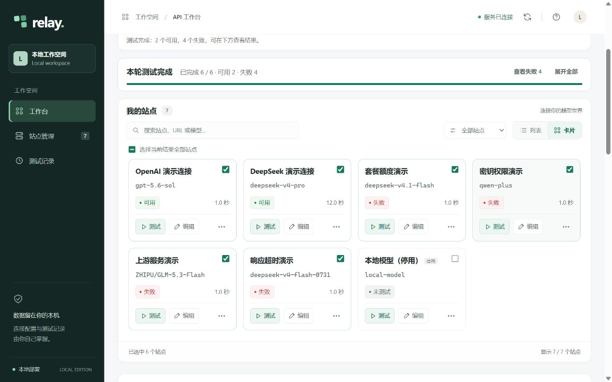
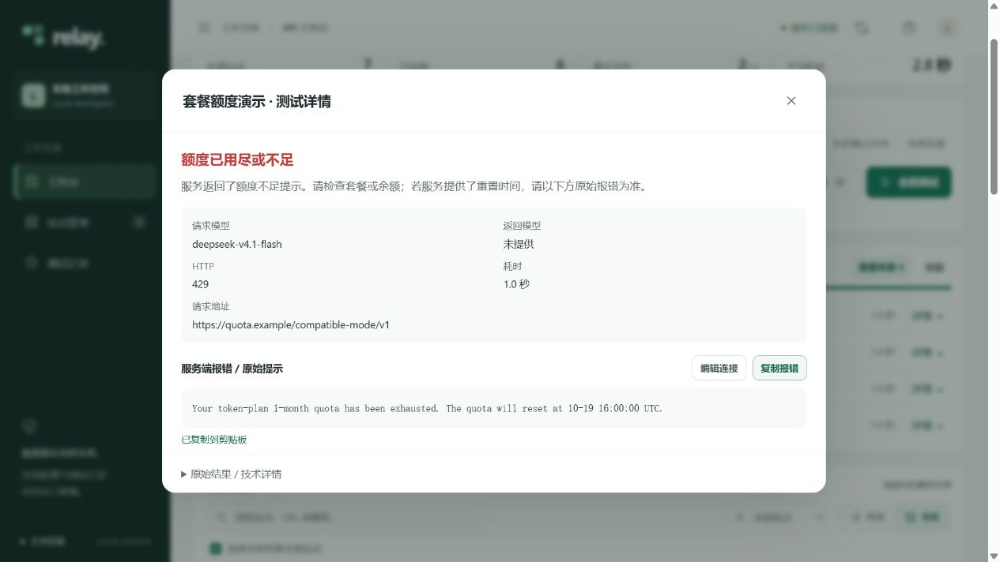

# LLM API Tester

[](https://github.com/youxin01/llm-api-tester/graphs/contributors)
[](https://github.com/youxin01/llm-api-tester/stargazers)
[](https://github.com/youxin01/llm-api-tester/forks)

[](LICENSE)
[](https://www.python.org/)
[](https://fastapi.tiangolo.com/)
[](#local-deployment-and-privacy)

[中文](README.md) | [English](README.en.md)

**A local LLM API tester built with Python and FastAPI.**

Enter a URL and key to discover models, test connections and inspect replies or errors.
No account or frontend build required.

[Quick start](#quick-start) · [Features](#features) · [Privacy](#local-deployment-and-privacy)

## Preview



<details>
<summary>View error details</summary>



</details>

*Screenshots use fictional connections and simulated results.*

## Features

- 🔑 **Connections:** manage multiple APIs; view, copy and replace keys.
- 🔎 **Model discovery:** retrieve the service’s model list with a URL and key.
- ⚡ **Batch testing:** test one, selected or all connections with progress updates.
- 📋 **Direct results:** click a status for replies, HTTP status, duration and errors.
- 🖥️ **Desktop workspace:** list/card views, search, filters and history.
- ⚙️ **Request settings:** reasoning, output limits, timeout and custom headers.
- 💬 **Reusable prompts:** save tasks; includes knowledge-cutoff and pelican tests.
- 🎨 **Content preview:** preview HTML/SVG animations, inspect source and download.
- 🌐 **Chinese / English:** switch languages with a remembered preference.

Supports **OpenAI-compatible Chat Completions**, including compatible services for GPT,
DeepSeek, Qwen, GLM and local vLLM. Available models and parameters depend on the provider.

## Quick start

Requires **Python 3.10+**. Use the same commands on Windows, macOS and Linux:

```bash
git clone https://github.com/youxin01/llm-api-tester.git
cd llm-api-tester
python -m pip install -r requirements.txt
python app.py
```

Open **http://127.0.0.1:8765**. If your system uses `python3`, replace `python` accordingly.

## Usage

1. **Add a connection:** enter a name, URL, key and model, or use **Check key / models**.
2. **Run a test:** choose a prompt and connections, then start testing.
3. **Inspect results:** click a status for details; HTML/SVG replies can be previewed.

<details>
<summary>Optional settings</summary>

- The initial model is `gpt-5.6-sol`, editable. A listed model does not guarantee access.
- Blank output limits and Temperature use provider defaults; request timeout `0` means no timeout.
- Reasoning choices depend on the API; switch-only formats offer on/off, not effort levels.
- LongCat streams automatically upstream; results display after collection, preserving partial output on disconnect.
- Leave the key blank when editing to keep it. Custom prompts are stored in this browser.

</details>

## Local deployment and privacy

- 🏠 Configuration and history stay locally, with no project-operated relay or telemetry uploads.
- 🔐 Keys are plaintext in `data/endpoints.json`; history is in `data/history.json`. Do not publish them.
- 📡 Tests send your key and prompt to your chosen API and may consume quota. Use trusted services.
- 🖥️ The server listens on `127.0.0.1` for local use; do not expose it directly to the internet.

## Development

<details>
<summary>Run tests (Node.js required for frontend tests)</summary>

```bash
python -m unittest discover -s tests -v
node --test static/api_key.test.cjs
```

</details>

## License

[MIT License](LICENSE) · Copyright © 2026 youxin01
